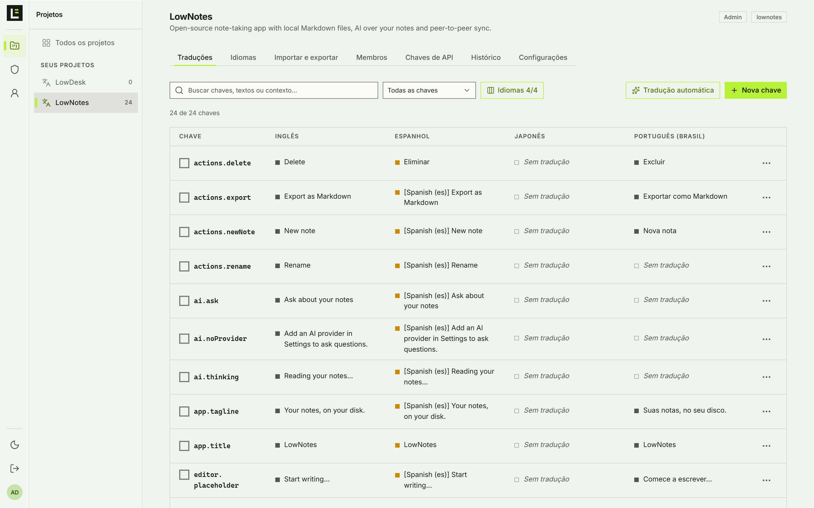
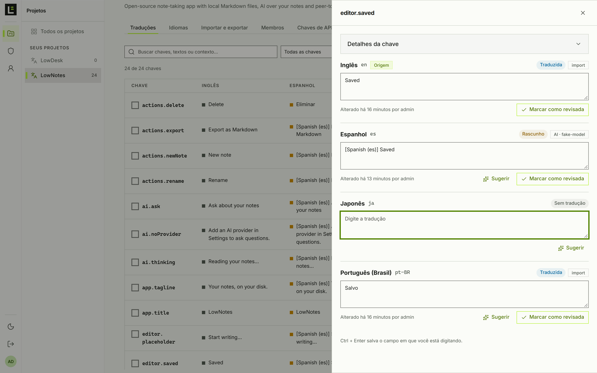
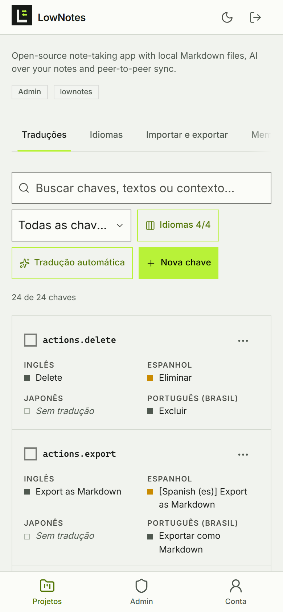

<p align="center">
  
</p>

<h1 align="center">LowLex</h1>

<p align="center">
  A light translation server for apps and the people who translate them.<br>
  One binary, one SQLite file. Run it from a download or with Docker Compose.
</p>

<p align="center">
  <a href="LICENSE"></a>
</p>

---

LowLex keeps the keys and translations of your apps in one place, lets developers and translators work on them with their own roles, fills gaps with machine translation or any OpenAI-compatible AI model, and hands the files back to your build in the formats it already reads. It is to translation management what PocketBase is to a backend: a single executable with the web UI inside, no Java, no Postgres, no Redis.

| | |
| --- | --- |
| **Runs as** | One static binary for Linux (any distribution, Arch included), macOS and Windows, or one container |
| **Stores data in** | `lowlex_data/lowlex.db` (SQLite, WAL) plus `secret.key` for provider credentials |
| **Uses** | About 15 MB of disk and a few tens of MB of RAM; starts in milliseconds |
| **Backend** | Go standard library, pure-Go SQLite (`modernc.org/sqlite`), argon2id passwords |
| **Web UI** | SvelteKit (static) with [CodeAtlas UI](https://ui.codeatlas.com.br/), in English and Brazilian Portuguese |



| Editing every language of a key | On a phone |
| --- | --- |
|  |  |

## Features

- **Projects, languages and namespaces.** Each project has a base language, any number of target languages (any BCP 47 code) and optional namespaces that become folders in exports.
- **People and roles.** Global accounts are *admin* or *user*. Inside a project each person is a *manager*, *developer*, *reviewer*, *translator* or *viewer*, and translators and reviewers can be limited to some languages. Reviewed texts are locked for translators.
- **First sign-in.** The first admin is `admin` with the password `lowlex`, and LowLex asks for a new one before anything else. Or set `LOWLEX_ADMIN_PASSWORD` to start with your own.
- **Translation editor.** Search keys, texts and context; filter by missing, draft, not reviewed or reviewed per language; pick which language columns to show; edit every language of a key side by side; `Ctrl + Enter` saves.
- **Machine translation and AI.** Google Cloud Translation, DeepL, Microsoft Translator, LibreTranslate and any OpenAI-compatible chat API (OpenAI, OpenRouter, Groq, Ollama, LM Studio, vLLM…). Ask every provider for a suggestion on one text, or fill a whole language in one go as drafts. AI providers get the project description, the key name and its context, keep placeholders (`{name}`, `{{count}}`, `%s`, ICU plurals, tags) and can follow your own instructions or glossary. Provider keys are encrypted at rest (AES-256-GCM).
- **Import and export.** JSON (flat or nested, i18next / vue-i18n style), CSV with every language in one sheet, Gettext PO, Android `strings.xml`, Apple `.strings` and Java `.properties`. Upload one file or a ZIP of many: the language comes from the file name and folders become namespaces.
- **API keys per project.** Read keys for apps and builds, write keys for CI. Every endpoint the UI uses also takes an API key.
- **Activity history** per project.

## Get started

### Option 1: the binary

1. Download the archive for your system from the releases page and extract it.
2. Optionally copy `.env.example` to `.env` next to the binary and edit it.
3. Run it:

```bash
./lowlex
```

On Windows run `lowlex.exe`. Open <http://localhost:4747>, sign in as `admin` / `lowlex` and choose your own password.

Data goes to `./lowlex_data` unless `LOWLEX_DATA_DIR` says otherwise. To run it as a service on Linux, a systemd unit is enough:

```ini
[Unit]
Description=LowLex
After=network.target

[Service]
User=lowlex
WorkingDirectory=/opt/lowlex
ExecStart=/opt/lowlex/lowlex
Restart=on-failure

[Install]
WantedBy=multi-user.target
```

### Option 2: Docker Compose

```bash
cp .env.example .env    # set LOWLEX_ADMIN_PASSWORD
docker compose up -d
```

`compose.yaml` builds the image from this repository, keeps the data in the `lowlex_data` volume and publishes port `4747` (change it with `LOWLEX_PORT` in `.env`). The image is `distroless/static` running as a non-root user, with a built-in health check.

## Settings

Settings come from environment variables or a `.env` file in the current directory or next to the binary. Variables already set in the environment win.

| Variable | Default | |
| --- | --- | --- |
| `LOWLEX_HOST` | `0.0.0.0` | Address to listen on |
| `LOWLEX_PORT` | `4747` | Port |
| `LOWLEX_DATA_DIR` | `./lowlex_data` | Database and key file |
| `LOWLEX_ADMIN_USER` | `admin` | First admin, created when the database is empty |
| `LOWLEX_ADMIN_PASSWORD` | empty | First admin's password. Empty means `lowlex`, which must be changed at the first sign-in |
| `LOWLEX_PUBLIC_URL` | empty | External URL behind a proxy; `https://` turns on secure cookies |
| `LOWLEX_SECRET` | generated | Encrypts provider credentials. Keep it if you set it |
| `LOWLEX_LOG_REQUESTS` | `false` | Log every request |

Forgot the admin password? Stop the server and run `lowlex reset-password admin`: it prints a temporary password that must be changed at the next sign-in.

## Use it from your app or CI

Create an API key in the project (**API keys** tab) and send it as `X-API-Key`.

```bash
# download pt-BR as nested JSON
curl -H "X-API-Key: lx_..." "http://localhost:4747/api/projects/web-app/export?format=json-nested&lang=pt-BR" -o pt-BR.json

# every language as a ZIP of i18next files
curl -H "X-API-Key: lx_..." "http://localhost:4747/api/projects/web-app/export?format=json-nested" -o locales.zip

# upload the source strings from CI (write key)
curl -H "X-API-Key: lx_..." -F file=@locales/en.json "http://localhost:4747/api/projects/web-app/import"
```

Export parameters: `format` (`json`, `json-nested`, `csv`, `po`, `android`, `ios`, `properties`), `lang` (one code or a comma list; omitted means all), `ns` (one namespace), `state` (`translated` or `reviewed` to leave drafts out) and `fallback=base` to fill gaps with the base language.

Import fields (multipart): `file`, `lang` (otherwise from the file name), `namespace` (otherwise from the ZIP folder), `format` (otherwise from the extension), `state` (`translated`, `draft`, `reviewed`), `overwrite=true` to replace existing texts.

### Coming from Tolgee

In Tolgee, export the project as JSON with one file per language (ZIP), then import the ZIP into a LowLex project. Keys, languages and namespaces come across; review states start as *translated*.

## Develop

Requirements: Go 1.26+, Bun 1.4+.

```bash
cd web && bun install && bun run dev      # UI on :5173, proxies /api to :4747
go run ./cmd/lowlex                       # API on :4747
go test ./...
```

`scripts/build.sh` builds the UI and one binary per platform into `dist/`. The UI strings live in `web/src/lib/locales/*.json`, flat JSON that LowLex itself can import and export.

## License

[AGPL-3.0-only](LICENSE).
